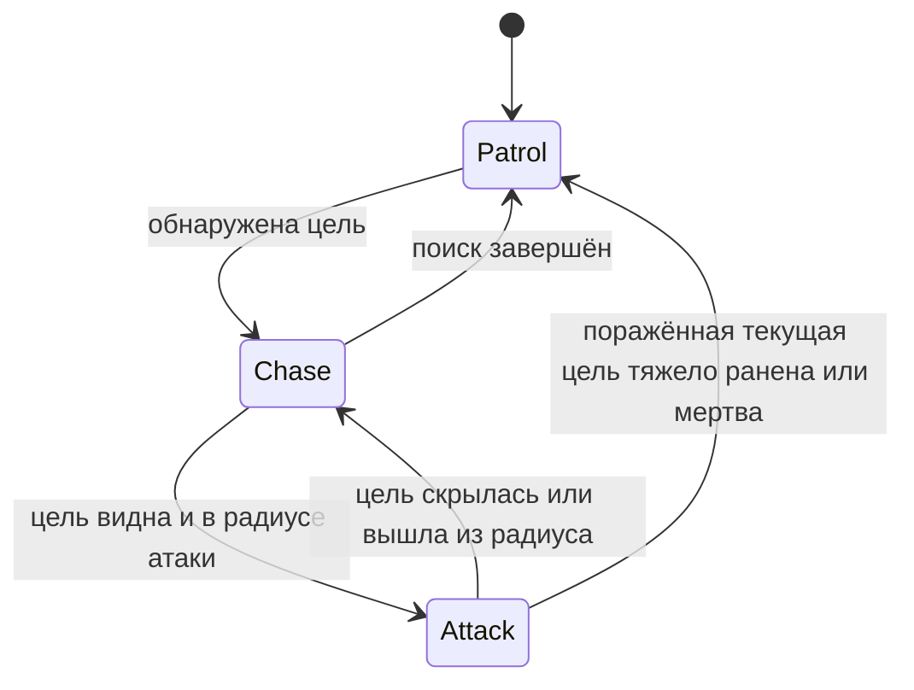

# Карта проекта Im3DTmp

Статический анализ репозитория `Alfarabius/Im3DTmp`, commit `29e0bd2b2ce53f4913689bfb3296be56fbbad7be`.
Изучены все 25 скриптов основной логики в `Assets/Scripts`, активные префабы, их переопределения в GameScene, Input Actions и связанные Animator Controllers. Всего в Assets 47 C# файлов, включая импортированный контроллер и старые варианты управления.
Запуск Unity, компиляция и игровое тестирование не выполнены: облачный Editor не активирован. Наблюдения ниже относятся к исходникам и сериализованным данным, а не к результатам Play Mode.

## Игровая задача и сцена

Игрок убегает от вооружённого Enemy, который также охотится на NPC. Текущая цель — открыть 7 из 10 LootBox.

- Unity 6000.3.8f1, revision 1c7db571dde0; Universal Render Pipeline 17.3.0.
- Input System 1.18.0, AI Navigation 2.0.10, Cinemachine 3.1.7, UGUI и TextMesh Pro.
- Единственная включённая сцена в EditorBuildSettings — `Assets/Scenes/GameScene.unity`. SampleScene выключена.
- В GameScene размещены экземпляры префабов: Player ×1, Enemy ×1, NPC ×16, LootBox ×10, CoverPoint ×56.
- У PatrolPoints 40 дочерних Transform, которые PatrolState читает как маршрутные точки.
- Сцена содержит NavMeshSurface с назначенными запечёнными NavMeshData.
- Основные префабы находятся в `Assets/Prefabs`; одноимённые модели в других каталогах не следует принимать за активную игровую логику.
- В сцене `enableLootBoxWin = true`, `requiredLootBoxes = 7`, `enableEnemyDeathWin = false`, `enablePlayerDeathLoss = true`.
- В коде GameManager значение enableEnemyDeathWin по умолчанию true, но сцена переопределяет его на false. При анализе баланса приоритет у сериализованных значений сцены/префабов.
- Конец игры сейчас вызывает немедленную перезагрузку текущей сцены после Debug.Log. Отдельного экрана победы/поражения в этой цепочке нет.

## Организация логики

Основная архитектура — MonoBehaviour-компоненты с конечными автоматами состояний. Это не ECS и не централизованная система обновления.

`ICharacterState` объявляет `Enter()`, `UpdateState()`, `Exit()`. Brain хранит текущее состояние и передаёт ему обновление. Состояния сами являются MonoBehaviour и расположены рядом с соответствующим Brain на том же объекте. Переходы используют GetComponent другого состояния.

В том же файле `ICharacterState.cs` определён `ITargetable`: TargetWeight, TargetTransform, Condition, TryApplyHit(float), IsPlayer(). PlayerBrain и NPCBrain реализуют этот контракт. TargetCondition объявлен в NPCBrain.cs, но используется обоими персонажами: Normal → Wounded → HeavyWounded → Dead.

GameManager, PauseManager, CoverManager, ScreamManager используют статическое свойство Instance. Это менеджеры сцены; DontDestroyOnLoad в них не применяется.

### Player

- `Player/PlayerBrain.cs` — состояние здоровья, стамина, смена состояний, получение вероятностного попадания и Heal().
- `Player/PlayerActiveState.cs` — CharacterController, ходьба, спринт, приседание, прыжок с буферизацией и coyote time, гравитация, взгляд мышью и наклоны Q/E.
- В префабе скорости: ходьба 2.5, бег 5, приседание 1, раненый 2. Стамина 100; расход спринта 15/с, восстановление 10/с, порог выхода из истощения 15.
- TargetWeight в префабе равен 2, при приседании становится 0.5. Это влияет на обнаружение и выбор цели, а не только на вероятность выбора игрока.
- Обычное ранение обнуляет стамину, отключает бег/прыжок через ветвление движения и задаёт Animator IsWounded.
- `PlayerHeavyWoundedState` останавливает обычное управление, переподчиняет BodycamTarget к HeadBone, запускает HeavyWounded и через 10 секунд вызывает гарантированное попадание для смерти.
- `PlayerDeadState` запускает Dead и через 2.5 секунды сообщает о поражении GameManager.
- `PlayerDamageEffects` подписан на OnHitReceived и выстрелы: звук попадания/пролёта, виньетка, обесцвечивание, Cinemachine impulse. Промах обрабатывается в LateUpdate, чтобы попадание в том же кадре могло отменить эффект промаха.
- Рабочие контроллеры анимации/камеры: GingerPlayer.controller и Cinemachine. Global Volume назначен через override экземпляра в GameScene, хотя в префабе ссылка пустая.

### Enemy

- `EnemyBrain` владеет NavMeshAgent, Animator, стаминой и текущей ITargetable-целью. В Start ждёт кадр, пытается посадить агента на NavMesh и включает PatrolState.
- Обнаружение: OverlapSphere по слоям Player/Target, сектор зрения, всенаправленная ближняя зона и Raycast по слою Obstacle.
- Близкая цель получает немедленный приоритет. Иначе выбор случайный с весом `TargetWeight / distance`, а не строго по ближайшей цели.
- `PatrolState` обходит ещё не посещённые точки, предпочитая ближайшие, осматривается на 360°, сканирует каждые 0.3 с. Через 5 с движения в этом состоянии выбирает патрульную точку, ближайшую к Player.
- `ChaseState` сохраняет последнюю известную позицию, помнит цель 5 с; после потери исследует точку. Лимит исследования 3 с, также есть выход по достижению/некорректному маршруту. Бег 5, истощённая ходьба 2.
- В префабе: стамина 150, радиус сканирования 35, угол 60°, всенаправленная зона 8, мгновенная зона 3, атака до 20. Во время Chase радиус текущей цели меняется на 20.
- `AttackState` сближается до 90% AttackDistance, поворачивается и стреляет раз в 2 с при угле до 15°.
- Сначала публикуется глобальное событие выстрела, затем Raycast поражает первый объект по маске целей и препятствий. Это не отдельный летящий projectile.
- Вероятность принятия попадания — 0.7 для NPC и 0.5 для Player при текущем значении префаба. Сначала луч должен попасть в коллайдер ITargetable, затем цель делает вероятностную проверку.
- Активный контроллер анимации — GingerEnemy.controller. Строки параметров Speed, IsAiming и Attack связаны с C#.
- В основной цепочке нет здоровья Enemy и подключённого оружия Player. Метод ReportEnemyDeath существует, но вызовов в C# нет, и эта победа выключена в сцене.

### NPC и укрытия

- NPCIdleState восстанавливает стамину и проверяет зрение; при обнаружении врага переходит в NPCRunawayState.
- Любой слышимый выстрел в радиусе 40 переводит не тяжелораненого и не мёртвого NPC к бегству, передавая позицию стрелка.
- NPCRunawayState ищет достижимый маршрут от угрозы, пробует несколько направлений, затем случайные запасные точки. Бег 5/ходьба 2 зависят от стамины.
- Через 5 с без визуального контакта NPC начинает искать укрытие. Повторное обнаружение угрозы отменяет подход к укрытию.
- CoverManager хранит зарегистрированные CoverPoint, проверяет достижимость и углы NavMesh-маршрута относительно угрозы. Выбирает ближайшее безопасное укрытие, иначе более далёкое от угрозы запасное.
- Общий HashSet резервирует укрытия, к которым уже бегут NPC; физическая занятость дополнительно проверяется OverlapSphere. Есть локальный blacklist.
- NPCAlertedState стоит настороже, восстанавливает стамину и следит за врагом.
- NPCStressedState останавливает NPC на 4 с, затем переводит в Alerted. Стресс может возникнуть при неудачной вероятностной проверке попадания.
- Первое ранение NPC обнуляет как текущую, так и максимальную стамину. Тяжёлое ранение выключает текущую машину состояний, останавливает агента и включает зацикленный крик боли. Следующее принятое попадание убивает NPC и выключает CapsuleCollider.
- Голосом управляют NPCVoiceController и ScreamManager: индивидуальная вероятность/пауза и глобальный лимит одновременной частоты криков.
- Активный Animator — GingerNPC.controller. Шаги вызываются Animation Events `PlayStepSound` из метаданных анимаций, а не единым таймером движения.

### LootBox, ввод, пауза и звук

- LootBox определяет Player по LayerMask в триггере, показывает подсказку, управляет emission через MaterialPropertyBlock.
- F открывает коробку один раз: выключает триггер/подсказку/свечение, лечит вошедшего PlayerBrain, создаёт назначенный lootPrefab и вызывает GameManager.RegisterLootBoxOpened().
- Количество для победы — сериализованная настройка GameManager, поэтому изменение 7 не требует менять логику LootBox.
- Основной Input Actions asset — `Assets/Input/PlayerControls.inputactions`, на него ссылаются PlayerInput, PlayerActiveState, LootBox и PauseManager.
- Карта Player: WASD, Shift, C/LeftCtrl, Space, Q/E, F, мышь, Pause на Esc/Tab. Карта UI содержит Resume на Esc/Tab. Action/AltAction назначены на кнопки мыши, но основное состояние Player их не использует.
- Также существует шаблонный `Assets/InputSystem_Actions.inputactions`; он назначен в EditorBuildSettings configObjects. Его нельзя путать с PlayerControls, используемым перечисленными компонентами.
- PauseManager устанавливает Time.timeScale, AudioListener.pause, переключает карты ввода и курсор. UI callbacks реально привязаны в GameScene.
- Настройки сохраняются в PlayerPrefs. Чувствительность применяется через override процессоров Look, громкости — через AudioMixer, разрешение — через Screen.SetResolution. Методы выбора языка пока пустые.
- GlobalAudioEvents.OnGunshotFired — публичный статический Action с позицией и направлением; на него подписаны NPCBrain и PlayerDamageEffects.
- FootstepsAudio временно меняет pitch/volume общего AudioSource и восстанавливает их корутиной.
- SnowGenerator создаёт ParticleSystem у камеры, если дочернего OptimizedSnowSystem ещё нет.

## Конвенция основной логики

Это наблюдаемый стиль проекта: отдельного AGENTS.md, .editorconfig или документа соглашений не обнаружено.

- Основные классы в глобальном namespace; импортированный пакет EvolveGames использует свой namespace и другой стиль.
- Отступы четыре пробела, фигурные скобки на новой строке.
- Классы/интерфейсы/методы/свойства — PascalCase; аргументы и локальные переменные — camelCase.
- Закрытые поля состояния — `_camelCase`; закрытые настройки Inspector — `[SerializeField] private camelCase`.
- Публичные свойства часто имеют private set. Для Inspector используется `[field: SerializeField] public ... { get; private set; }`.
- Header/Tooltip группируют баланс и ссылки; комментарии преимущественно русские, заголовки Inspector смешанные русские/английские.
- Awake кеширует компоненты и начальные значения, Start запускает поведение; OnEnable/OnDisable подписывают и отписывают обработчики.
- Используются RequireComponent, ранние return, null-check и `?.`; однострочные методы иногда записаны через `=>`.
- Состояния используют явные Enter/UpdateState/Exit; отдельного Unity Update у каждого состояния нет.
- Баланс и сценовые ссылки задаются в Inspector. Не следует переносить их в код или новую систему конфигурации без отдельной задачи.
- Имена сериализованных полей, имена backing fields сериализованных свойств, GUID из .meta, имена Animator-параметров и Animation Events — часть связей проекта. Переименования требуют сохранения этих связей.
- Public методы PauseManager связаны с UnityEvents в сцене; их имена тоже нельзя менять без обновления привязок.
- Для будущих исправлений: следовать ближайшему существующему стилю, делать изменения по конкретной проблеме, сохранять архитектуру Brain/State и не переписывать импортированные/старые контроллеры без необходимости.

## Уточнения автора и пояснения к наблюдениям

Это не список подтверждённых ошибок. Пункты сохраняют исходную нумерацию для связи с обсуждением. Уточнения автора определяют ожидаемое поведение; предположения статического анализа не заменяют эти требования. Игровой код по этим наблюдениям не изменён.

1. **Ожидаемое поведение.** Удержание Sprint после расхода стамины намеренно блокирует восстановление при попытке продолжать бег. Это наказание за панически зажатый Shift; не исправлять.
2. **По подтверждению автора пауза работает правильно.** Отсутствие проверки IsPaused в каждом состоянии само по себе не является ошибкой: используются timeScale и отключение карт ввода.
3. **В игровом процессе лечение из HeavyWounded недоступно.** Наличие соответствующей ветки в Heal() не доказывает достижимость этого сценария. Невозврат родителя камеры после такого лечения не установлен как текущая игровая проблема.
4. **Ожидаемое поведение.** Повторный выбор тяжелораненого персонажа намеренный: Enemy не знает наверняка, умерла ли жертва. Не исключать HeavyWounded из выбора целей.
5. **Требование автора:** TargetWeight должен обеспечивать приоритет целей внутри VisionRadius. Текущая формула выбора — TargetWeight / distance; дополнительно код использует TargetWeight в проверках дальности и ближнего обнаружения. Сфера первоначального поиска ограничена VisionRadius. Замечание не означает, что её нужно увеличивать вместе с весом. Если менять роль веса, отдельно согласовать влияние приседания на обнаружение.
6. **Неиспользуемое поле, без установленного игрового дефекта.** ChaseState перед возвращением к патрулю записывает последнюю позицию цели в GeneralPatrolArea. PatrolState это поле не читает и выбирает точки своим существующим способом. При этом подход к последней позиции в ChaseState реализован. Речь только о том, что эта запись не влияет на последующий патруль; необходимость такого влияния автором не заявлена.
7. **Условный сценарий, не воспроизведённая ошибка.** NPC резервирует укрытие, когда бежит к нему, и освобождает его в Exit. Если сторонняя будущая логика выключит/удалит NPC во время этого бега без перехода состояния, резерв может остаться и другие NPC будут считать укрытие занятым. Текущее тяжёлое ранение вызывает Exit и освобождает резерв; наличие сбоя в обычном игровом процессе не установлено.
8. **Ограничение оценки пути.** CoverManager проверяет расстояние от угрозы до углов NavMesh-маршрута. Участок между двумя далёкими от врага углами всё ещё может проходить близко к нему: например, точки по разные стороны от Enemy. Поэтому такая проверка не гарантирует удалённость всего пути от врага. Воспроизведения на текущей карте нет; также код явно допускает запасной опасный маршрут, если безопасного не нашлось.
9. **Возможное следствие для эффектов, не утверждение о нанесении урона.** Событие выстрела публикуется до Raycast; PlayerDamageEffects проверяет близость к направлению выстрела без его фактической длины. Поэтому потенциально возможны звук пролёта и виньетка у Player за стеной, в которую попала пуля. Сам урон ограничен Raycast. Нужно ли отсекать такой эффект — отдельное решение по дизайну, а не автоматически ошибка.
10. **Переносимость настройки разрешения.** Screen.resolutions зависит от текущего дисплея/ОС; подключение другого монитора или смена его режима между запусками может изменить число и порядок доступных разрешений/частот. Сохраняется индекс, а не ширина/высота, поэтому прежний индекс может обозначать другой режим. TMP_Dropdown ограничивает значение своим списком, так что один только устаревший индекс не доказывает выход за границы массива в обычной UI-цепочке. Исходное замечание о возможной ошибке было недостаточно обосновано. Отдельный случай пустого списка требует проверки на целевой платформе, которая пока не определена.

## Границы проверки и последующая работа

Автоматические игровые тесты, собственные test assemblies, CI workflow и custom build method в checkout не обнаружены. Установленный Test Framework сам по себе не означает наличие тестов.

Есть следы подготовки WebGL в настройках и комментариях. Целевая платформа релиза пользователем пока не определена; не считать WebGL окончательным требованием.

Прочитанная модель позволяет работать над точечными исправлениями. Для утверждений о поведении, производительности и готовности к релизу нужны воспроизведение и проверки в активированном Unity. Исходники, сцены и префабы в ходе анализа не изменены.
