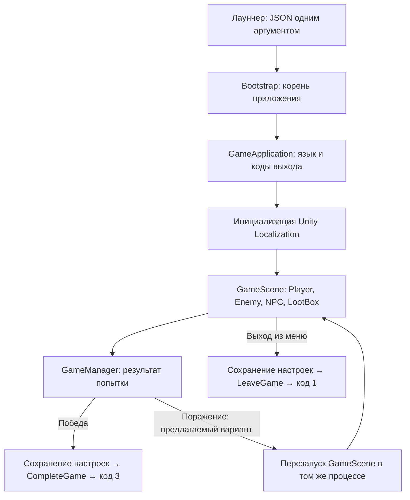

# Предложение: лаунчер издателя и локализация RU/EN

Основания: присланный `GameApplication.cs`, видимая часть изображения со спецификацией и текущий код игры. Это проект интеграции, а не уже выполненная интеграция. Код издателя не запускался. В игровой код в рамках этого анализа изменения не вносились.

Автор подтвердил целевую платформу релиза: **Windows**. Рекомендуемая архитектура билда — Windows x86_64. WebGL остаётся для быстрых игровых тестов.

## 1. Что требует предоставленный контракт

На изображении виден вводный раздел: лаунчер готовит окружение, запускает игру с аргументами командной строки, асинхронно ждёт завершения процесса и обрабатывает его код выхода. Подробности кодов и JSON ниже получены из C# файла; разделы 2 и 3 спецификации, на которые ссылаются комментарии, на изображении не видны.

| Действие | Реализация в GameApplication.cs |
|---|---|
| Входные данные | Первый аргумент после пути EXE: JSON вида `{"lang":"ru"}` или `{"lang":"en"}` |
| Нормализация языка | Пробелы по краям удаляются, регистр игнорируется; только `ru` выбирает русский, остальные значения дают `en` |
| Нет аргумента / повреждён JSON | Английский |
| Unity Editor | `editorOverrideLang` из Inspector; командная строка редактора не разбирается |
| Досрочный выход | `LeaveGame()`, код 1 |
| Успешное прохождение | `CompleteGame()`, код 3 |
| Имитация системной ошибки | `SimulateSystemError()`, код -1 |
| Закрытие окна / Alt+F4 | Перехват `Application.wantsToQuit`, досрочный выход с кодом 1 |
| Окна и фокус ОС | В предоставленном решении относятся к ответственности лаунчера |

Лаунчер должен передать JSON **одним аргументом**, сохранив кавычки внутри него. Дополнительные флаги Unity при текущем парсере должны идти после JSON: скрипт читает именно `args[1]`, а не ищет конфигурацию среди всех аргументов. Лаунчеру нужно ждать фактический процесс игры и различать именно коды 1 и 3; общее правило «любой ненулевой код = ошибка» здесь не подходит.

Код -1 на уровне Windows представлен как `0xFFFFFFFF`. Его знаковое представление зависит от API чтения результата. Другие неожиданные коды/реальные аварии нельзя считать успешным прохождением. `SimulateSystemError()` проверяет возврат заранее заданного кода, но не моделирует все свойства настоящего падения Unity.

## 2. Почему недостаточно добавить компонент в GameScene

1. `ApplyLocalization()` в приложенном файле пустой. Сам по себе скрипт ничего не переводит.
2. `GameManager.EndGame()` сейчас перезагружает сцену и при победе, и при поражении. При победе процесс останется жив и лаунчер не получит код 3.
3. `PauseManager.UIQuit()` вызывает обычный `Application.Quit()`. Скрипт издателя перехватит такой выход, но явная связь с LeaveGame лучше выражает контракт и позволяет сохранить настройки перед выходом.
4. Скрипт использует `kernel32.dll` и `TerminateProcess` за условием `!UNITY_EDITOR`. Это условие включает WebGL, хотя Windows API для него недоступен.
5. `TerminateProcess` обходит нормальное завершение Unity. Нельзя рассчитывать на сохранение настроек, файлов или аналитики из OnDestroy/OnApplicationQuit после этого вызова.
6. Есть тестовый JSON-параметр `auto`: коды 1, 3, -1 завершают процесс через две реальные секунды. Он прямо обозначен как расширение вне спецификации.
7. Компонент не содержит собственной защиты от дублей и сохранения между сценами. Его жизненный цикл нужно организовать на уровне приложения.

Комментарии о зависаниях обычного выхода описывают опыт автора присланного решения; они не доказывают, что Application.Quit зависает во всех Unity Windows-билдах. Самовольно заменять механизм издателя до проверки совместимости не предлагается.

## 3. Предлагаемая структура

**Bootstrap.unity** становится первой сценой Windows и WebGL-профилей. В ней расположен единственный корень приложения с DontDestroyOnLoad. Он содержит интеграцию издателя, сервис локализации и маршрутизацию выхода. После получения языка и готовности локализации загружается GameScene. Это исключает показ меню на неправильном языке и запуск геймплея во время асинхронной загрузки таблиц.

GameManager, PauseManager и остальные менеджеры игровой сцены остаются сценовыми. Перезапуск GameScene создаёт новую попытку, но не пересоздаёт интеграцию издателя и не сбрасывает выбранный язык. Для тестирования прямого входа в GameScene в Editor нужен предусмотренный тестовый запуск Bootstrap, без второго экземпляра GameApplication.

Предлагаемые зоны ответственности:

- **GameApplication / адаптер издателя**: входной JSON, AppliedLanguage, согласованные exit codes и Windows-завершение процесса.
- **ApplicationBootstrap**: единственный корень приложения, порядок инициализации и загрузка игровой сцены.
- **LocalizationService**: начальная локаль, переключение RU/EN и готовность таблиц. При использовании штатных компонентов Unity пакет сам обновляет локализованные надписи.
- **GameSessionController**: единая точка Leave/Complete, сохранение настроек до выхода и отдельная реализация поведения для Editor/WebGL.
- **GameManager**: победа/поражение и прогресс LootBox. Не разбирает CLI, не переводит интерфейс и не вызывает Windows API.

Нужен один компонент издателя, а не одновременно базовый GameApplication и его наследник. Точка `protected virtual ApplyLocalization()` пригодна для адаптера, который запускает инициализацию LocalizationService по AppliedLanguage. Его завершения ждёт Bootstrap. При наследовании нельзя случайно перекрыть private lifecycle-методы базового класса и потерять разбор аргументов или подписку на wantsToQuit; альтернативой служит согласованная небольшая адаптация исходного класса.

## 4. Изменения конкретно в текущей игре

| Место | Предлагаемое изменение |
|---|---|
| GameManager.EndGame(true) | При достижении настроенного requiredLootBoxes сообщить GameSessionController об успехе; в Windows завершить игру кодом 3 вместо перезагрузки |
| GameManager.EndGame(false) | Предлагается сохранить повтор попытки через перезагрузку GameScene, без завершения процесса; это решение нужно сверить с трактовкой сессии издателем |
| PauseManager.UIQuit | Сначала PlayerPrefs.Save(), затем выход через GameSessionController / LeaveGame с кодом 1 |
| PauseManager.UIRestart | Перезапуск только GameScene; не выдаёт лаунчеру код завершения и сохраняет язык текущего процесса |
| PauseManager.SetLanguageRussian / SetLanguageEnglish | Существующие привязки кнопок оставить, пустые методы связать с LocalizationService |
| LootBox | Сохранить существующую передачу прогресса в GameManager; локализовать подсказку в префабе |
| PlayerDeadState | Оставить сообщение о смерти в GameManager; не связывать персонажа напрямую с лаунчером |
| Профили сборки | Отдельные Windows x86_64 Release, Windows Development для интеграционных проверок и WebGL для игровых тестов |

Порог победы берётся из текущей настройки, не фиксируется числом 7 в интеграции или переводах. Подтверждённые автором механики стамины, ранений, выбора жертвы и патрулирования не затрагиваются.

На первом этапе при победе предлагается завершать процесс сразу, как требует текущий метод CompleteGame. Если позже понадобится экран победы, результат нужно зафиксировать до его показа и согласовать поведение Alt+F4 после победы: присланный файл без такой адаптации считает закрытие окна досрочным выходом.

## 5. Минимальная адаптация платформенного кода

С издателем нужно согласовать допустимость технических изменений его исходника при сохранении внешнего протокола:

1. **Windows API только для `UNITY_STANDALONE_WIN && !UNITY_EDITOR`.** Ограничить и объявления DllImport, и все вызовы TerminateSelf. В WebGL не разбирать десктопную командную строку и не пытаться завершать процесс ОС; отображать тестовый результат/перезапускать попытку. В Editor не завершать процесс редактора.
2. **Сохранение до принудительного завершения.** При сохранении TerminateProcess нужен общий предварительный обработчик для всех штатных путей выхода, включая Alt+F4. Меню можно провести через обёртку, но только обёртка не перехватит Alt+F4 раньше прямого TerminateSelf внутри GameApplication. Если файл менять запрещено, данные должны сохраняться заранее при изменениях, как сейчас сохраняются настройки PauseManager; обещать финальный flush из OnApplicationQuit нельзя.
3. **Тестовый auto только в тестовом/Development-билде.** Windows Release его игнорирует. Параметр не должен позволять оформить успешное прохождение без выполнения игровой цели в пользовательском релизе.
4. **Идемпотентное завершение.** Повторные сигналы выхода не должны запускать повторное сохранение/противоречивые результаты; фактическое поведение при неуспешном TerminateProcess также нужно проверить.

Если издатель требует побайтово неизменный файл, это ограничение необходимо знать до реализации. Текущий файл одновременно в неизменном виде и для Windows-интеграции, и для безопасных WebGL-тестов не подходит без изоляции его платформенной реализации.

## 6. Локализация

Рекомендация — штатный **Unity Localization** с двумя Locale (`ru`, `en`) и String Table Collections. Пакет сейчас в manifest отсутствует. При реализации выбрать совместимую с Unity 6000.3 версию и зафиксировать зависимости в manifest/lockfile. Таблицы и шрифты поставляются локально в билде; сеть для выбора языка не нужна.

Не распределять переводы по if/else в PauseManager, LootBox и GameApplication. Не искать строки по их текущему английскому тексту. Использовать стабильные ключи и ссылки на таблицы:

| Ключ | RU | EN |
|---|---|---|
| menu.resume | Продолжить | Resume |
| menu.restart | Начать заново | Restart |
| menu.quit | Выйти | Quit |
| settings.language | Язык | Language |
| settings.resolution | Разрешение | Resolution |
| settings.mouse_sensitivity | Чувствительность мыши | Mouse sensitivity |
| settings.master_volume | Общая громкость | Master volume |
| settings.ambient_volume | Громкость окружения | Ambient volume |
| settings.sfx_volume | Громкость эффектов | Sound effects volume |
| interaction.open_loot | [{key}] Открыть | [{key}] Open |
| hud.loot_progress — для будущего HUD | Открыто ящиков: {opened}/{required} | Boxes opened: {opened}/{required} |

`{key}`, `{opened}`, `{required}` — подстановки, а не зафиксированные F и 7. Подсказка получает обозначение кнопки из InputAction. Если потребуются формы «ящик/ящика/ящиков», использовать Smart Strings, а не ручную конкатенацию. Имена языков в переключателе можно показывать как «Русский» и «English» независимо от текущего языка.

В сцене используются TextMesh Pro; для надписей подходят LocalizeStringEvent с обновлением TMP_Text.text и соответствующие локализованные ссылки для динамических строк. Подписки должны работать и для изначально неактивной панели паузы, и для новых экземпляров префабов после перезапуска сцены. Debug.Log и внутренние имена Animator не являются пользовательским интерфейсом и перевода не требуют.

### Приоритет языка

- **Windows через лаунчер:** значение из JSON. Отсутствие/ошибка аргумента/неизвестный язык → en, как в присланном файле. Язык ОС, Unity System Locale Selector и старые PlayerPrefs не должны переопределять это правило.
- **Unity Editor:** inspector override, аналогично присланному скрипту.
- **WebGL для тестов:** явный тестовый выбор/переключатель RU/EN; выход в лаунчер в браузере не проверяется.
- **Кнопки RU/EN в игре:** предлагается разрешить менять язык текущей сессии. Следующий запуск из лаунчера снова применяет его lang. Допустимость такого переключателя уточнить у издателя, если он считает свой язык обязательным на всю сессию.

Поскольку инициализация Unity Localization асинхронная, сначала задаётся выбранная локаль и загружаются нужные таблицы, затем разрешается запуск GameScene. Если bootstrap из-за ошибки не может закончить локализацию, это должно дать диагностируемый результат, а не бесконечное молчаливое ожидание.

### Шрифты и вёрстка

Текущий UI использует `LiberationSans SDF.asset` (GUID 8f586378b4e144a9851e7b34d9b748ee): в его статическом атласе 250 символов, проверенных А/Я/а/я/Ё/ё нет. Динамический fallback существует, но фактическое отображение русского в билде ещё не проверено. По одному этому факту нельзя утверждать, что все русские символы сейчас обязательно отсутствуют на экране.

В исходных `HomeVideo-Regular.ttf` и `HomeVideo-Bold.ttf` проверено наличие этих русских букв. Предлагается сгенерировать TMP-атлас выбранного шрифта с латиницей, полным русским алфавитом включая Ё/ё, цифрами и используемой пунктуацией. Назначить его UI или настроить проверенный fallback. Отдельно проверить длинные русские подписи, переносы, кнопки и минимальный читаемый размер; один Auto Size не гарантирует подходящую вёрстку.

## 7. Проверки после реализации

| Проверка | Ожидаемый результат |
|---|---|
| Windows EXE + JSON ru/en одним аргументом | Нужный язык при первом показе UI |
| Нет аргумента / неверный JSON / неподдерживаемый lang | en, процесс запускается |
| JSON перед дополнительными флагами Unity | Аргумент читается корректно |
| Выполнено requiredLootBoxes | Процесс заканчивается, лаунчер получает 3 |
| Выход из меню / Alt+F4 / крестик окна до победы | 1, настройки сохранены, лаунчер продолжает работу |
| Перезапуск/предлагаемый повтор после смерти | Новая попытка в том же процессе, язык сохранён, нет дубля GameApplication |
| Development auto=1,3,-1 | Ожидаемый код за примерно 2 реальные секунды |
| Release с auto=3 | Автовыход не выполняется |
| Реальная авария или принудительное завершение извне | Не трактуется как победа; launcher обрабатывает фактический результат процесса |
| Переключение RU/EN при открытой паузе, после перезапуска, у LootBox | Надписи обновляются, ключи/квадраты вместо букв не появляются |
| WebGL smoke test | Нет обращений к kernel32, работают обе локали и игровой повтор |

Проверку аргументов/кодов делать и на отдельном EXE, и из настоящего лаунчера. Завершение процесса нельзя подтвердить только Play Mode в Editor или WebGL. Windows-билд должен включать весь Unity output-каталог, включая Data, DLL и локализационные ресурсы, а не один EXE. Лаунчер не должен зависеть от произвольного текущего рабочего каталога: пути к ресурсам определяются стандартными путями Unity.

## 8. Что уточнить до реализации

1. Допускаются ли перечисленные платформенные адаптации GameApplication.cs или нужен неизменный исходник?
2. Смерть игрока означает повтор в том же процессе или окончание лаунчерной сессии? Отдельного кода поражения в предоставленном файле нет. Предлагаемый вариант — повтор; если требуется закрытие без успеха, согласовать код 1, не назначать -1 игровому поражению.
3. Можно ли переключать язык внутри сессии после получения lang от лаунчера?

Это конкретные пробелы предоставленного контракта, а не препятствие подготовке архитектуры и переводов. Изображение не содержит оставшиеся разделы спецификации; при появлении полной версии проверить предложение на дополнительные ограничения.

## 9. Порядок реализации

1. Уточнить контракт выхода и допустимость адаптации файла, подготовить Bootstrap и Windows-профиль.
2. Интегрировать единый путь завершения и выполнить Windows-проверки кодов на минимальном приложении.
3. Подключить Unity Localization, RU/EN-таблицы, TMP-атлас и начальный язык из GameApplication.
4. Связать результат GameManager и кнопки PauseManager, локализовать сцену и LootBox-префаб.
5. Проверить полный сценарий из лаунчера и отдельно WebGL smoke test.

Анализ исходников и наличие символов в исходных шрифтах проверены. Сборка, запуск лаунчера, коды выхода, отображение локализованного UI и совместимость WebGL ещё не проверялись: реализации пока нет.
